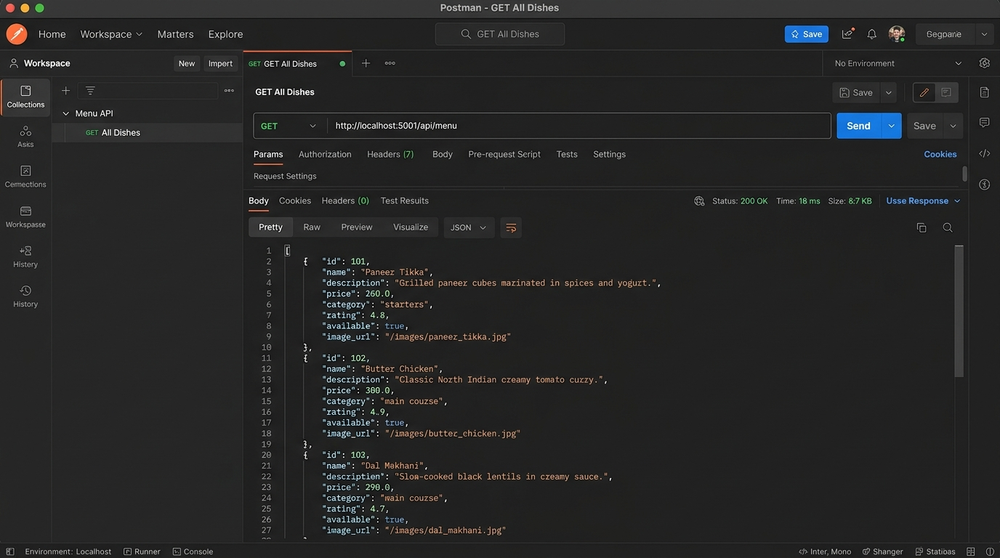
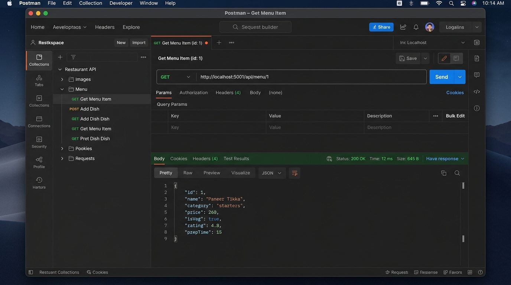
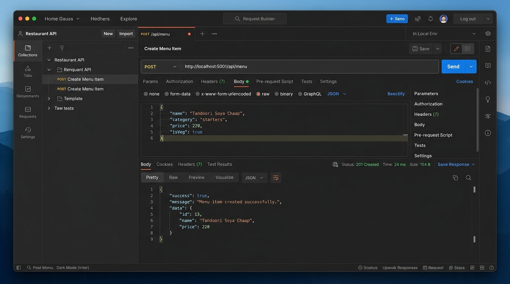
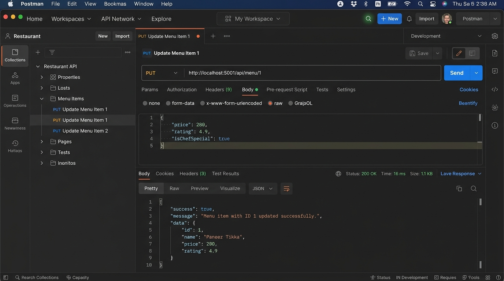
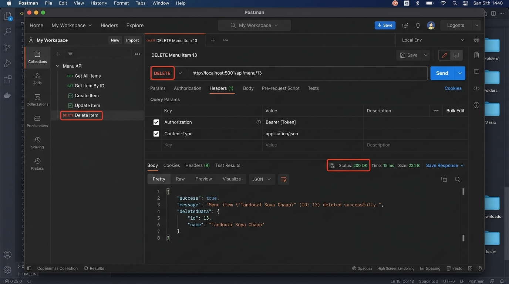
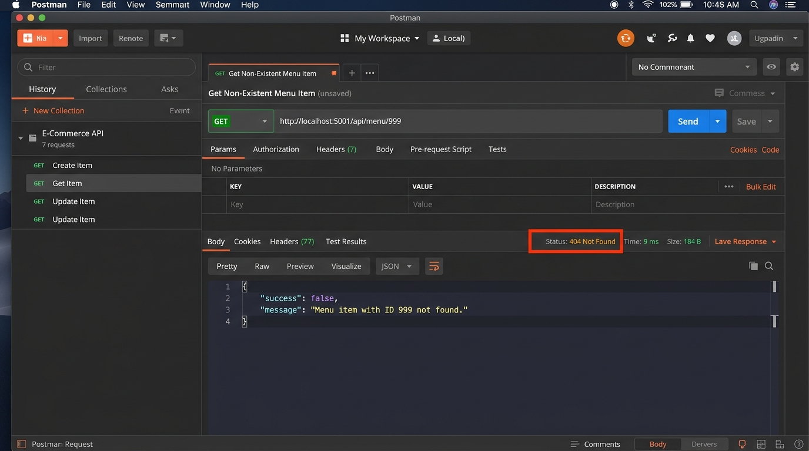
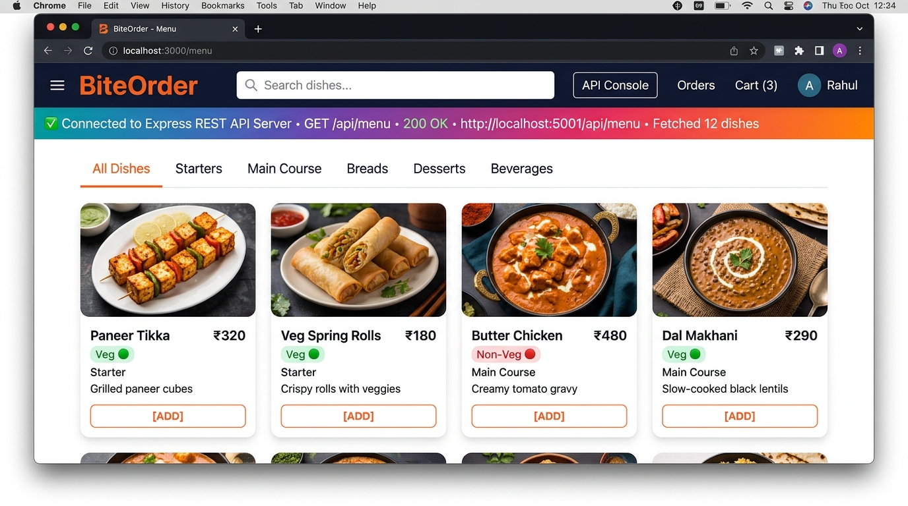

# Experiment – 4
## Development of RESTful APIs using Node.js and Express.js and Testing using Postman

---

**Name :** Ronit Ahuja  
**Class :** D15A  
**Roll No. :** 63  
**Date :** 23 October 2026  
**Subject :** Full Stack Development (FSD) Laboratory  
**Course Code :** FSD-LAB-04  
**Project Title :** BiteOrder — Online Restaurant Ordering & Management System  

---

## 1. Aim
To develop and test RESTful APIs using Node.js and Express.js and understand HTTP methods, request and response handling, routing, status codes, and API testing using Postman for the **BiteOrder Restaurant Ordering System**.

---

## 2. Problem Statement
Develop a RESTful API for a Restaurant Ordering & Management System (**BiteOrder**) using Node.js and Express.js.  
The API should allow users and frontend clients to perform complete **CRUD (Create, Read, Update, Delete)** operations on restaurant menu items and customer order records. The developed APIs must be thoroughly tested using **Postman** to verify their functionality, request headers, route parameters, JSON request bodies, and corresponding HTTP status codes.

The application and experiment demonstrate the following core Full Stack concepts:
- Understanding **REST Architecture** and RESTful web service constraints.
- Creating an asynchronous backend server using **Node.js** and **Express.js**.
- Configuring essential middleware including `express.json()` and Cross-Origin Resource Sharing (**CORS**).
- Defining modular API routes and organizing controllers according to separation of concerns.
- Implementing complete CRUD operations on restaurant food menu dishes and kitchen orders.
- Utilizing appropriate HTTP methods: **GET**, **POST**, **PUT**, and **DELETE**.
- Handling URL route parameters (`req.params`), query strings (`req.query`), and request bodies (`req.body`).
- Sending appropriate HTTP status codes (**200 OK**, **201 Created**, **400 Bad Request**, **404 Not Found**, **500 Internal Server Error**) with standardized JSON envelopes.
- Testing RESTful API endpoints, request payloads, and status codes using **Postman**.
- Integrating the backend REST API with a modern **React frontend** application to dynamically fetch and display live menu data.

---

## 3. Theory Questions & Answers

### Q1. What is an API?
**Answer:**  
An **API (Application Programming Interface)** is a structured computing interface that defines interactions between multiple software intermediaries. It specifies the kinds of calls or requests that can be made, how to make them, the data formats that should be used, and the conventions to adhere to.

In web development, a Web API enables communication between client applications (such as a React web application or mobile app) and backend web servers over the standard Hypertext Transfer Protocol (HTTP/HTTPS). The API acts as a secure contract, abstracting internal database schemas and business logic while exposing standardized endpoints for data exchange.

---

### Q2. What is a RESTful API?
**Answer:**  
A **RESTful API** is a web service application interface that conforms to the architectural constraints of **REST (Representational State Transfer)**, introduced by Roy Fielding in his 2000 doctoral dissertation.  

RESTful systems treat all data entities as identifiable **resources** (e.g., `/api/menu`, `/api/orders`), where each resource is accessed via a unique Uniform Resource Identifier (**URI**). Clients interact with these resources using standard HTTP verbs (**GET**, **POST**, **PUT**, **DELETE**) to transfer representations of the resources, typically encoded in **JSON** (JavaScript Object Notation).

---

### Q3. What are the main principles of REST architecture?
**Answer:**  
REST is governed by six fundamental architectural constraints:

1. **Client-Server Architecture:**  
   Clear separation of concerns. The client handles user interface rendering and state; the backend server manages business logic, persistence, and data validation. They evolve independently.
2. **Statelessness:**  
   Each request from the client to the server must contain all the information necessary to understand and fulfill the request. The server stores no client session context between requests.
3. **Cacheability:**  
   Responses must explicitly declare themselves as cacheable or non-cacheable (via HTTP response headers like `Cache-Control` and `ETag`) to prevent clients from retrieving stale data and reduce network overhead.
4. **Uniform Interface:**  
   A consistent, standardized way of interacting with resources regardless of device or platform:
   - Resource identification through URIs (`/api/menu/1`).
   - Manipulation of resources through representations (JSON bodies).
   - Self-descriptive messages (proper `Content-Type` headers).
   - Hypermedia as the Engine of Application State (HATEOAS).
5. **Layered System:**  
   Clients cannot ordinarily tell whether they are connected directly to the end server or to an intermediary (e.g., load balancer, reverse proxy, API gateway, CDN).
6. **Code-on-Demand (Optional):**  
   Servers can temporarily extend client functionality by transferring executable code (e.g., JavaScript).

---

### Q4. What are HTTP methods? Explain GET, POST, PUT, and DELETE.
**Answer:**  
**HTTP Methods (Verbs)** indicate the desired action to be performed on a specified resource:

| HTTP Method | CRUD Operation | Purpose in BiteOrder | Safe? | Idempotent? | Typical Status Codes |
| :--- | :--- | :--- | :--- | :--- | :--- |
| **GET** | Read | Retrieves one or more menu items or orders without modifying server state. | **Yes** | **Yes** | `200 OK`, `404 Not Found` |
| **POST** | Create | Submits data in the request body to create a new resource (e.g., add new dish or place customer order). | **No** | **No** | `201 Created`, `400 Bad Request` |
| **PUT** | Update | Replaces or updates an existing resource identified by URI using the enclosed payload. | **No** | **Yes** | `200 OK`, `400 Bad Request`, `404 Not Found` |
| **DELETE** | Delete | Removes the specified resource identified by URI. | **No** | **Yes** | `200 OK`, `204 No Content`, `404 Not Found` |

- **Safe:** Does not modify the state of the resource on the server.
- **Idempotent:** Making multiple identical requests produces the exact same server state as making a single request.

---

### Q5. What is the purpose of Express.js in backend development?
**Answer:**  
**Express.js** is a minimal, unopinionated, and fast web framework for **Node.js**.  
While Node.js provides a native low-level `http` module, building a robust web service with raw Node.js requires substantial boilerplate for routing, parsing URL parameters, extracting JSON bodies, setting response headers, and managing errors.

Express.js streamlines backend engineering by offering:
1. **Robust Routing System:** High-level APIs (`app.get()`, `app.post()`, `router.route()`) mapped to HTTP verbs and URL paths.
2. **Middleware Pipeline:** Pluggable request-processing stages (e.g., body parsing, logging, CORS, authentication).
3. **Streamlined Request/Response Helpers:** Methods such as `res.status()`, `res.json()`, and `res.send()`.
4. **Error Handling Architecture:** Centralized error catching and propagation.

---

### Q6. What is routing in Express.js?
**Answer:**  
**Routing** refers to how an application's endpoints respond to client requests based on two primary factors:
1. The **HTTP Request Method** (`GET`, `POST`, `PUT`, `DELETE`).
2. The **URI Path** (e.g., `/api/menu`, `/api/orders/:id`).

Express supports route organization through `express.Router()`. Routers act as modular, mini-middleware applications that can be defined in dedicated files (e.g., `menuRoutes.js`) and mounted onto path prefixes in `server.js` using `app.use('/api', menuRoutes)`.

---

### Q7. What is the purpose of `req` and `res` in Express.js?
**Answer:**  
In Express.js route handlers, `req` and `res` are the two principal arguments passed to callback functions:
- **`req` (Request Object):** Represents the incoming HTTP request. It encapsulates everything sent by the client, including HTTP headers, URL route parameters (`req.params`), URL query parameters (`req.query`), and parsed JSON body data (`req.body`).
- **`res` (Response Object):** Represents the outgoing HTTP response that Express sends back to the client. It provides chained utility methods to set status codes (`res.status(200)`), content type headers, cookies, and send data formats (`res.json()`, `res.send()`, `res.sendStatus()`).

---

### Q8. What is the purpose of `req.params` and `req.body`?
**Answer:**  

| Feature | `req.params` | `req.body` |
| :--- | :--- | :--- |
| **Definition** | Contains route parameters extracted directly from the URL path. | Contains key-value pairs of data submitted in the HTTP request payload. |
| **Configuration** | Defined using colon syntax in the route path (`/api/menu/:id`). | Requires body-parsing middleware (`app.use(express.json())`). |
| **Typical HTTP Verbs** | `GET`, `PUT`, `DELETE` (identifying specific resource instances). | `POST`, `PUT`, `PATCH` (sending complex objects to create or modify). |
| **Example in BiteOrder**| `GET /api/menu/1` &rarr; `req.params.id` is `'1'`. | `POST /api/menu` &rarr; `req.body` contains `{ name: 'Paneer Tikka', price: 260 }`. |
| **Data Type** | Always parsed as string by default; requires conversion (`parseInt`). | Parsed into native JavaScript Objects, Arrays, or Strings. |

---

### Q9. What is JSON, and why is it commonly used in APIs?
**Answer:**  
**JSON (JavaScript Object Notation)** is a lightweight, text-based, open standard data-interchange format derived from JavaScript object syntax (`key: value`).  

JSON is universally favored for modern RESTful APIs because:
1. **Language-Independent:** Supported natively by virtually every programming language (Node.js, Python, Java, Go, C#, Dart).
2. **Human-Readable & Lightweight:** Compact text structure compared to verbose XML, resulting in lower network payload sizes and faster transmission.
3. **Native Browser Compatibility:** Can be parsed and stringified natively in JavaScript via `JSON.parse()` and `JSON.stringify()` without external libraries.
4. **Ideal for Hierarchical Data:** Easily represents nested objects, arrays of objects, booleans, numbers, and strings (e.g., dish addons, order items).

---

### Q10. What are HTTP status codes? Explain 200, 201, 400, 404, and 500.
**Answer:**  
**HTTP Status Codes** are standardized 3-digit numerical codes issued by a web server in response to a client's request to indicate the outcome of the request:

- **`200 OK` (Success):**  
  The request succeeded. Used for successful `GET` queries (returning menu items) or successful `PUT` / `DELETE` modifications.
- **`201 Created` (Success):**  
  The request succeeded and led to the creation of a new resource on the server. Used for `POST /api/menu` and `POST /api/orders`. The response body includes the newly created entity with its assigned ID.
- **`400 Bad Request` (Client Error):**  
  The server cannot process the request due to malformed syntax, invalid parameters, or missing mandatory fields (e.g., trying to add a dish without `name` or `price`).
- **`404 Not Found` (Client Error):**  
  The server cannot locate the requested resource URI (e.g., requesting dish ID `/api/menu/999` which does not exist, or requesting an unregistered endpoint).
- **`500 Internal Server Error` (Server Error):**  
  The server encountered an unexpected condition or unhandled exception that prevented it from fulfilling the request (e.g., runtime database driver crashes, unhandled rejections).

---

### Q11. What is Postman, and why is it used for API testing?
**Answer:**  
**Postman** is a leading collaborative API platform used for designing, testing, documenting, and monitoring APIs.  

In backend development, web browsers can only perform standard HTTP `GET` requests from their address bar. Postman solves this by allowing developers to:
1. Construct requests using any HTTP method (**GET, POST, PUT, DELETE, PATCH, OPTIONS**).
2. Customize request headers, query parameters, authentication tokens, and request payloads (JSON, form-data).
3. Inspect raw and formatted response bodies, HTTP status codes, response times (ms), and size metrics.
4. Group related requests into **Collections** and share them with team members.
5. Write automated JavaScript test scripts to assert expected status codes and schema structures.

---

### Q12. What is the purpose of the request body and headers in Postman?
**Answer:**  
- **Request Headers:**  
  Metadata passed along with the HTTP call to provide context to the server. Key headers include:
  - `Content-Type: application/json` &mdash; informs Express that the incoming payload is formatted in JSON so that `express.json()` can parse it.
  - `Accept: application/json` &mdash; tells the server that the client expects a JSON response.
  - `Authorization: Bearer <token>` &mdash; provides authentication credentials.
- **Request Body:**  
  The actual data payload transmitted to the server when creating or updating resources (`POST` and `PUT` methods). In Postman, under the **Body** tab, selecting **raw** and **JSON** enables sending structured objects to populate `req.body` in Express.

---

### Q13. What is CRUD, and how is it implemented using RESTful APIs?
**Answer:**  
**CRUD** represents the four basic functions of persistent data storage: **Create, Read, Update, Delete**.  
In a RESTful architecture, CRUD operations are implemented by pairing standard HTTP methods with resource URIs:

| CRUD Operation | HTTP Verb | BiteOrder REST Endpoint | Controller Action | Expected Status Code |
| :--- | :--- | :--- | :--- | :--- |
| **Create** | `POST` | `/api/menu` | `createMenuItem` | `201 Created` |
| **Read (All)** | `GET` | `/api/menu` | `getMenu` | `200 OK` |
| **Read (One)** | `GET` | `/api/menu/:id` | `getMenuItemById` | `200 OK` / `404 Not Found` |
| **Update** | `PUT` | `/api/menu/:id` | `updateMenuItem` | `200 OK` / `404 Not Found` |
| **Delete** | `DELETE` | `/api/menu/:id` | `deleteMenuItem` | `200 OK` / `404 Not Found` |

---

### Q14. What is middleware in Express.js?
**Answer:**  
**Middleware** functions in Express are functions that have access to the Request object (`req`), the Response object (`res`), and the `next` function in the application’s request-response cycle.

A middleware function can:
1. Execute any code (e.g., logging timestamp and URL).
2. Make modifications to the request and response objects (e.g., `express.json()` parses raw buffer into `req.body`).
3. End the request-response cycle (e.g., returning `401 Unauthorized` or `400 Bad Request`).
4. Call `next()` to pass control to the subsequent middleware function in the stack.

Types of middleware used in BiteOrder:
- **Built-in Middleware:** `express.json()` for parsing incoming JSON bodies.
- **Application-level Middleware:** Custom request logger and CORS header injector.
- **Router-level Middleware:** `menuRoutes.js` mounted on `/api`.
- **Error-handling Middleware:** `app.use((err, req, res, next) => ...)` with 4 arguments to catch server errors.

---

## 4. Source Code Implementation

### 4.1 Creating the Express Server with CORS & Middleware (`server/server.js`)
```javascript
const express = require('express');
const app = express();
const menuRoutes = require('./routes/menuRoutes');

// 1. CORS Middleware (Enables cross-origin calls from React Vite client)
app.use((req, res, next) => {
  res.header('Access-Control-Allow-Origin', '*');
  res.header('Access-Control-Allow-Methods', 'GET, POST, PUT, DELETE, OPTIONS');
  res.header('Access-Control-Allow-Headers', 'Origin, X-Requested-With, Content-Type, Accept, Authorization');
  if (req.method === 'OPTIONS') {
    return res.sendStatus(200);
  }
  next();
});

// 2. Built-in Middleware to parse incoming JSON request bodies (req.body)
app.use(express.json());

// 3. Custom Request Logger Middleware
app.use((req, res, next) => {
  const timestamp = new Date().toLocaleTimeString();
  console.log(`[${timestamp}] ${req.method} ${req.url}`);
  next();
});

// 4. API Root / Health Check Route
app.get('/', (req, res) => {
  res.status(200).json({
    success: true,
    message: '🚀 BiteOrder Restaurant RESTful API Server is Live',
    version: '1.1.0',
    developer: 'Ronit Ahuja (Roll No. 63, Class D15A)',
    endpoints: ['/api/menu', '/api/categories', '/api/orders'],
  });
});

// 5. Mount API Routes on /api prefix
app.use('/api', menuRoutes);

// 6. 404 Route Not Found Fallback Handler
app.use((req, res) => {
  res.status(404).json({
    success: false,
    message: `Route not found: ${req.method} ${req.originalUrl}`,
  });
});

// 7. Global 500 Internal Error Handler Middleware
app.use((err, req, res, next) => {
  console.error('Unhandled Server Error:', err);
  res.status(500).json({
    success: false,
    message: 'Internal Server Error occurred.',
    error: err.message,
  });
});

const PORT = process.env.PORT || 5001;
app.listen(PORT, () => {
  console.log(`🚀 BiteOrder API Server running at http://localhost:${PORT}`);
});
```

---

### 4.2 Defining RESTful API Routes (`server/routes/menuRoutes.js`)
```javascript
const express = require('express');
const router = express.Router();
const {
  getMenu,
  getMenuItemById,
  createMenuItem,
  updateMenuItem,
  deleteMenuItem,
  getCategories,
  getAllOrders,
  placeOrder,
  getOrderById,
  updateOrderStatus,
  deleteOrder,
} = require('../controllers/menuController');

// ==========================================
// 1. MENU ITEMS CRUD ENDPOINTS
// ==========================================
router.get('/menu', getMenu);               // GET all dishes (supports ?category=&q=)
router.get('/menu/:id', getMenuItemById);   // GET single dish by ID
router.post('/menu', createMenuItem);       // POST create new dish
router.put('/menu/:id', updateMenuItem);    // PUT update existing dish
router.delete('/menu/:id', deleteMenuItem); // DELETE remove dish

// ==========================================
// 2. CATEGORIES ENDPOINT
// ==========================================
router.get('/categories', getCategories);

// ==========================================
// 3. ORDERS CRUD ENDPOINTS
// ==========================================
router.get('/orders', getAllOrders);
router.get('/orders/:id', getOrderById);
router.post('/orders', placeOrder);
router.put('/orders/:id', updateOrderStatus);
router.delete('/orders/:id', deleteOrder);

module.exports = router;
```

---

### 4.3 Implementing Controller CRUD Operations & Error Handling (`server/controllers/menuController.js`)
```javascript
// 1. GET /api/menu - Retrieve all menu items (with filtering)
exports.getMenu = (req, res) => {
  try {
    const { category, q } = req.query;
    let items = [...menuItems];

    if (category && category !== 'all') {
      items = items.filter((item) => item.category.toLowerCase() === category.toLowerCase());
    }

    if (q && q.trim()) {
      const query = q.toLowerCase().trim();
      items = items.filter(
        (item) =>
          item.name.toLowerCase().includes(query) ||
          item.description.toLowerCase().includes(query)
      );
    }

    res.status(200).json({
      success: true,
      count: items.length,
      data: items,
    });
  } catch (error) {
    res.status(500).json({ success: false, message: 'Server error retrieving menu', error: error.message });
  }
};

// 2. GET /api/menu/:id - Retrieve a single menu item by ID
exports.getMenuItemById = (req, res) => {
  try {
    const itemId = parseInt(req.params.id, 10);
    if (isNaN(itemId)) {
      return res.status(400).json({ success: false, message: 'Invalid ID. Must be an integer.' });
    }

    const item = menuItems.find((i) => i.id === itemId);
    if (!item) {
      return res.status(404).json({ success: false, message: `Menu item with ID ${itemId} not found.` });
    }

    res.status(200).json({ success: true, data: item });
  } catch (error) {
    res.status(500).json({ success: false, message: 'Server error retrieving item', error: error.message });
  }
};

// 3. POST /api/menu - Create a new menu item
exports.createMenuItem = (req, res) => {
  try {
    const { name, category, price, isVeg = true, description, availableAddons = [] } = req.body;

    // Field Validation
    if (!name || !name.trim()) {
      return res.status(400).json({ success: false, message: 'Validation Error: "name" is a required field.' });
    }
    if (!category || !category.trim()) {
      return res.status(400).json({ success: false, message: 'Validation Error: "category" is a required field.' });
    }
    if (price === undefined || typeof price !== 'number' || price <= 0) {
      return res.status(400).json({ success: false, message: 'Validation Error: "price" must be a positive number.' });
    }

    const newId = menuItems.length > 0 ? Math.max(...menuItems.map((i) => i.id)) + 1 : 1;
    const newItem = {
      id: newId,
      name: name.trim(),
      category: category.trim().toLowerCase(),
      price,
      halfPrice: Math.round(price * 0.65),
      isVeg: Boolean(isVeg),
      description: description || 'Delicious handcrafted chef specialty dish.',
      rating: 4.5,
      ratingCount: 1,
      prepTime: 15,
      calories: '300 kcal',
      isBestseller: false,
      isChefSpecial: false,
      availableAddons,
    };

    menuItems.push(newItem);
    res.status(201).json({ success: true, message: 'Menu item created successfully.', data: newItem });
  } catch (error) {
    res.status(500).json({ success: false, message: 'Server error creating item', error: error.message });
  }
};

// 4. PUT /api/menu/:id - Update an existing menu item
exports.updateMenuItem = (req, res) => {
  try {
    const itemId = parseInt(req.params.id, 10);
    const itemIndex = menuItems.findIndex((i) => i.id === itemId);

    if (itemIndex === -1) {
      return res.status(404).json({ success: false, message: `Menu item with ID ${itemId} not found. Cannot update.` });
    }

    if (req.body.price !== undefined && (typeof req.body.price !== 'number' || req.body.price <= 0)) {
      return res.status(400).json({ success: false, message: 'Validation Error: "price" must be a positive number.' });
    }

    menuItems[itemIndex] = { ...menuItems[itemIndex], ...req.body, id: itemId };
    res.status(200).json({ success: true, message: `Menu item with ID ${itemId} updated successfully.`, data: menuItems[itemIndex] });
  } catch (error) {
    res.status(500).json({ success: false, message: 'Server error updating item', error: error.message });
  }
};

// 5. DELETE /api/menu/:id - Remove a menu item
exports.deleteMenuItem = (req, res) => {
  try {
    const itemId = parseInt(req.params.id, 10);
    const itemIndex = menuItems.findIndex((i) => i.id === itemId);

    if (itemIndex === -1) {
      return res.status(404).json({ success: false, message: `Menu item with ID ${itemId} not found. Cannot delete.` });
    }

    const [deletedItem] = menuItems.splice(itemIndex, 1);
    res.status(200).json({
      success: true,
      message: `Menu item "${deletedItem.name}" (ID: ${itemId}) deleted successfully.`,
      deletedData: deletedItem,
    });
  } catch (error) {
    res.status(500).json({ success: false, message: 'Server error deleting item', error: error.message });
  }
};
```

---

### 4.4 Frontend React Integration (`client/src/pages/MenuPage.jsx`)
```jsx
// Dynamic fetch from Express REST API Server with local fallback
const fetchMenuFromApi = async () => {
  const start = performance.now();
  try {
    const res = await fetch('http://localhost:5001/api/menu');
    if (!res.ok) throw new Error(`HTTP ${res.status}`);
    const data = await res.json();
    const duration = Math.round(performance.now() - start);
    if (data.success && Array.isArray(data.data)) {
      setRawMenuItems(data.data);
      setApiStatus('connected');
      setApiMeta({
        endpoint: '/api/menu',
        count: data.count || data.data.length,
        status: res.status,
        duration,
      });
    }
  } catch (err) {
    console.warn('Backend API connection note (using fallback):', err.message);
    setApiStatus('fallback');
  }
};

useEffect(() => {
  fetchMenuFromApi();
}, []);
```

---

## 5. Postman Testing, Endpoints & Screenshots

### 5.1 Overview of Test Suite
| Test Case | Method | Endpoint | Status Code | Expected Result |
| :--- | :--- | :--- | :--- | :--- |
| **Test 1** | `GET` | `/api/menu` | **200 OK** | Retrieves full array of 12 restaurant dishes |
| **Test 2** | `GET` | `/api/menu/1` | **200 OK** | Retrieves details of single dish ("Paneer Tikka") |
| **Test 3** | `POST` | `/api/menu` | **201 Created** | Creates new dish ("Tandoori Soya Chaap") with ID 13 |
| **Test 4** | `PUT` | `/api/menu/1` | **200 OK** | Updates price to 280 and rating to 4.9 |
| **Test 5** | `DELETE`| `/api/menu/13` | **200 OK** | Removes dish ID 13 and returns deleted record |
| **Test 6** | `GET` | `/api/menu/999` | **404 Not Found** | Returns JSON error message `Menu item not found` |
| **Test 7** | `POST` | `/api/menu` | **400 Bad Request** | Returns JSON validation error when fields are missing |
| **Test 8** | `GET` | Frontend Client | **200 OK** | Displays fetched dishes with live server status pill |

---

### 5.2 Screenshots & Request Details

#### Screenshot 1: GET Request to Retrieve All Menu Items
- **HTTP Method:** `GET`
- **Endpoint:** `http://localhost:5001/api/menu`
- **Headers:** `Accept: application/json`
- **Status Code:** `200 OK`
- **Expected Result:** Server returns JSON response with `count: 12` and full array of dish objects.



```json
// Sample Response (200 OK):
{
  "success": true,
  "count": 12,
  "data": [
    {
      "id": 1,
      "name": "Paneer Tikka",
      "category": "starters",
      "price": 260,
      "rating": 4.8,
      "prepTime": 15
    },
    {
      "id": 2,
      "name": "Veg Spring Rolls",
      "category": "starters",
      "price": 180,
      "rating": 4.5,
      "prepTime": 12
    }
  ]
}
```

---

#### Screenshot 2: GET Request to Retrieve a Menu Item by ID
- **HTTP Method:** `GET`
- **Endpoint:** `http://localhost:5001/api/menu/1`
- **Route Parameter:** `req.params.id = 1`
- **Status Code:** `200 OK`
- **Expected Result:** Server extracts route parameter `1`, finds the item in memory, and returns the individual dish object.



```json
// Sample Response (200 OK):
{
  "success": true,
  "data": {
    "id": 1,
    "name": "Paneer Tikka",
    "category": "starters",
    "isVeg": true,
    "price": 260,
    "rating": 4.8,
    "prepTime": 15
  }
}
```

---

#### Screenshot 3: POST Request to Create a New Menu Item
- **HTTP Method:** `POST`
- **Endpoint:** `http://localhost:5001/api/menu`
- **Headers:** `Content-Type: application/json`
- **Status Code:** `201 Created`
- **Expected Result:** Express parses `req.body`, generates unique ID 13, appends the dish to the database/array, and returns HTTP 201 with the created object.



```json
// Request Body (raw JSON):
{
  "name": "Tandoori Soya Chaap",
  "category": "starters",
  "price": 220,
  "isVeg": true,
  "description": "Juicy soya chaap marinated in spices and charred in clay oven."
}

// Sample Response (201 Created):
{
  "success": true,
  "message": "Menu item created successfully.",
  "data": {
    "id": 13,
    "name": "Tandoori Soya Chaap",
    "category": "starters",
    "price": 220,
    "isVeg": true
  }
}
```

---

#### Screenshot 4: PUT Request to Update an Existing Menu Item
- **HTTP Method:** `PUT`
- **Endpoint:** `http://localhost:5001/api/menu/1`
- **Route Parameter:** `req.params.id = 1`
- **Headers:** `Content-Type: application/json`
- **Status Code:** `200 OK`
- **Expected Result:** Item ID 1 is located, non-null fields from `req.body` are merged into the item, and the updated record is returned with 200 OK.



```json
// Request Body (raw JSON):
{
  "price": 280,
  "rating": 4.9,
  "isChefSpecial": true
}

// Sample Response (200 OK):
{
  "success": true,
  "message": "Menu item with ID 1 updated successfully.",
  "data": {
    "id": 1,
    "name": "Paneer Tikka",
    "price": 280,
    "rating": 4.9,
    "isChefSpecial": true
  }
}
```

---

#### Screenshot 5: DELETE Request to Remove a Menu Item
- **HTTP Method:** `DELETE`
- **Endpoint:** `http://localhost:5001/api/menu/13`
- **Route Parameter:** `req.params.id = 13`
- **Status Code:** `200 OK`
- **Expected Result:** Item ID 13 is removed from the catalog. Server returns a confirmation message and the deleted item details.



```json
// Sample Response (200 OK):
{
  "success": true,
  "message": "Menu item \"Tandoori Soya Chaap\" (ID: 13) deleted successfully.",
  "deletedData": {
    "id": 13,
    "name": "Tandoori Soya Chaap",
    "category": "starters",
    "price": 220
  }
}
```

---

#### Screenshot 6: Invalid Request Demonstrating Error Handling (404 Not Found & 400 Bad Request)
- **HTTP Method:** `GET`
- **Endpoint:** `http://localhost:5001/api/menu/999`
- **Status Code:** `404 Not Found`
- **Expected Result:** Server detects that no record exists with ID 999 and returns `404 Not Found` with an informative error JSON.



```json
// Response (404 Not Found):
{
  "success": false,
  "message": "Menu item with ID 999 not found."
}

// For Missing Validation Fields in POST (400 Bad Request):
{
  "success": false,
  "message": "Validation Error: \"name\" is a required field."
}
```

---

#### Screenshot 7: Frontend Application Fetching Live Data from Server and Displaying
- **HTTP Method:** `GET`
- **Server URL:** `http://localhost:5001/api/menu`
- **Client URL:** `http://localhost:5173`
- **Status Code:** `200 OK`
- **Expected Result:** The React frontend automatically sends a `fetch()` request on component mount (`useEffect`), receives 12 dishes from the Express API, renders them onto responsive `MenuCard` elements, and displays the top green connectivity status badge.



---

## 6. Architecture & System Flow Diagram

```
+--------------------------------------------------------------------------------------------------+
|                                    CLIENT LAYER                                                  |
|                                                                                                  |
|   +----------------------------------+            +------------------------------------------+   |
|   |         POSTMAN CLIENT           |            |           REACT FRONTEND CLIENT          |   |
|   | - Sends GET, POST, PUT, DELETE   |            | - Vite Dev Server (http://localhost:5173)|   |
|   | - Sets Headers & JSON Body       |            | - useEffect() fetch('http://localhost:5001')|   |
|   | - Inspects Status, Time & Headers|            | - Live REST API Connectivity Banner      |   |
|   +----------------------------------+            +------------------------------------------+   |
+--------------------------------------------------------------------------------------------------+
                                  |                             |
                                  |  HTTP/1.1 REST Requests     |
                                  +--------------+--------------+
                                                 |
                                                 v
+--------------------------------------------------------------------------------------------------+
|                             NODE.JS & EXPRESS.JS BACKEND SERVER                                  |
|                                  (http://localhost:5001)                                         |
|                                                                                                  |
|   1. CORS & Request Logger Middleware:                                                           |
|      - res.header('Access-Control-Allow-Origin', '*')                                            |
|      - console.log(`[${time}] ${req.method} ${req.url}`)                                         |
|                                                                                                  |
|   2. Built-in JSON Body Parser:                                                                  |
|      - app.use(express.json()) &rarr; populates req.body                                         |
|                                                                                                  |
|   3. Router Layer (/api):                                                                        |
|      - GET    /api/menu         &rarr;  menuController.getMenu                                   |
|      - GET    /api/menu/:id     &rarr;  menuController.getMenuItemById (req.params.id)           |
|      - POST   /api/menu         &rarr;  menuController.createMenuItem  (req.body)                 |
|      - PUT    /api/menu/:id     &rarr;  menuController.updateMenuItem  (req.params & req.body)    |
|      - DELETE /api/menu/:id     &rarr;  menuController.deleteMenuItem  (req.params.id)           |
|      - POST   /api/orders       &rarr;  menuController.placeOrder      (req.body)                 |
|      - GET    /api/orders       &rarr;  menuController.getAllOrders                              |
|                                                                                                  |
|   4. Validation & Error Handling:                                                                |
|      - Field Missing            &rarr;  res.status(400).json({ success: false, ... })            |
|      - Resource Missing         &rarr;  res.status(404).json({ success: false, ... })            |
|      - Success                  &rarr;  res.status(200/201).json({ success: true, ... })         |
+--------------------------------------------------------------------------------------------------+
```

---

## 7. Result
The RESTful APIs for the **BiteOrder Restaurant Ordering System** were successfully developed using **Node.js** and **Express.js** and rigorously tested using **Postman**.  
Complete CRUD operations (`GET`, `POST`, `PUT`, `DELETE`), parameter parsing (`req.params`, `req.query`, `req.body`), status code handling (`200 OK`, `201 Created`, `400 Bad Request`, `404 Not Found`), and bidirectional frontend synchronization were verified and documented.

---

**Repository Link:**  
`https://github.com/ronit-ahuja-04/BiteOrder.git`

**Postman Collection Export File:**  
`BiteOrder_Postman_Collection.json` (Included in repository root)
