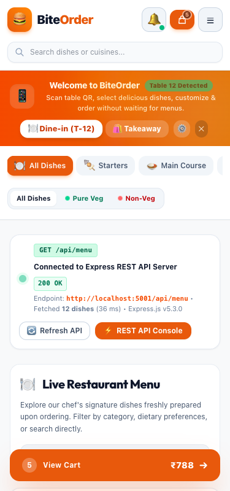
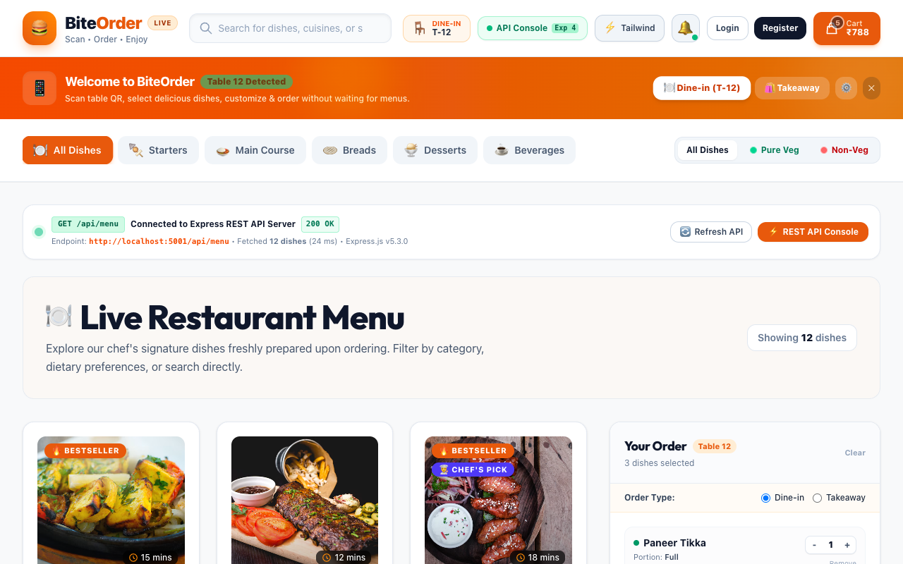
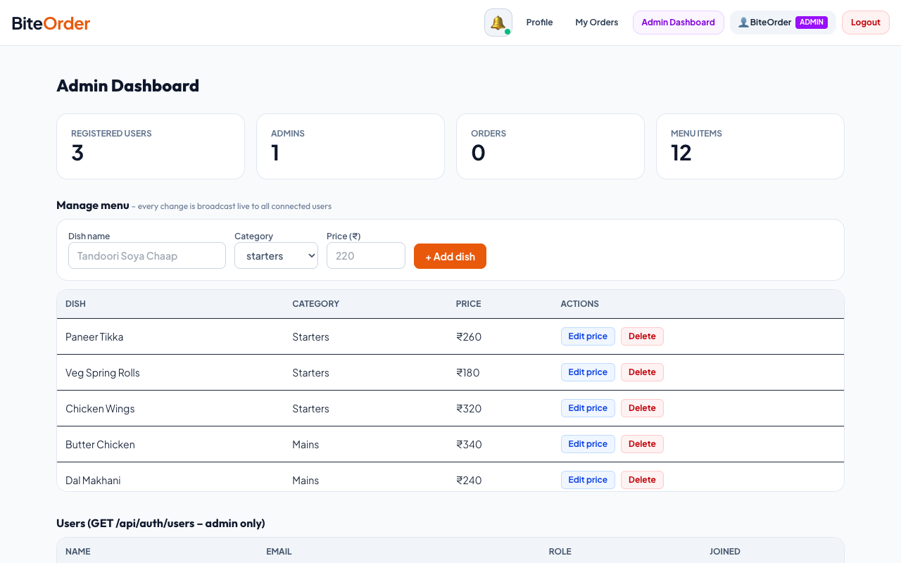
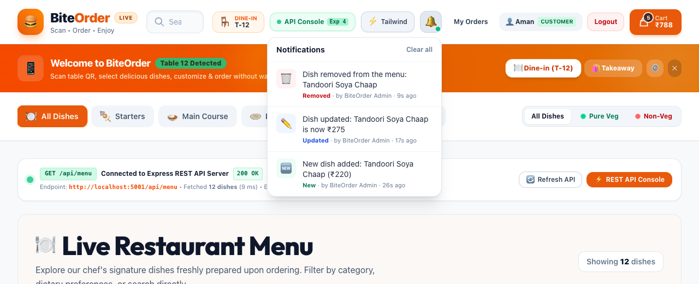

# BiteOrder — Online Restaurant Ordering & Management System

> Full Stack Development mini project · **Ronit Ahuja** · Class D15A · Roll No. 63
> Repository: https://github.com/ronit-ahuja-04/BiteOrder

**Live links** – Frontend: `<add Vercel URL after deploying>` · Backend API: `<add Render URL after deploying>` · API health: `<render-url>/health`

BiteOrder lets diners browse a live restaurant menu, customise dishes, order, and track their orders, while administrators manage the menu and see users and orders. Changes made by an admin appear instantly for every connected customer (real-time notifications).

## Features

| Area | What it does |
|---|---|
| Menu & ordering | Category / veg filters, debounced search, dish customiser, cart with GST, checkout, order tracking |
| Authentication | Register, login, logout, JWT sessions, protected pages |
| Roles (RBAC) | `customer` and `admin`; admin dashboard to add / edit / delete dishes and view users and orders |
| Real time | Socket.IO live notifications (toast, bell with unread count, menu refreshes by itself) |
| Security | bcrypt, JWT, validation, helmet, rate limiting, CORS allow-list, ownership checks (IDOR-safe) |
| Responsive UI | Phone, tablet and desktop layouts with a collapsible navigation menu |

## Tech stack

React 19 · Vite · Tailwind CSS v4 · React Router · Context API (Auth, Cart, Notification, Toast) · Node.js 20 · Express 5 · MongoDB + Mongoose · JWT + bcryptjs · Socket.IO · express-validator · helmet · morgan · Docker · GitHub Actions

## Architecture

```
┌────────────────────────┐   HTTPS / JSON (REST)    ┌──────────────────────────────┐        ┌───────────────┐
│  React SPA (Vite)      │ ───────────────────────► │  Express API  (server/)      │ ─────► │  MongoDB       │
│  Tailwind · Router     │ ◄─────────────────────── │  routes → middleware →       │ ◄───── │  (Atlas)       │
│  Context API + hooks   │                          │  controllers → Mongoose      │        │ users · orders │
│                        │   WebSocket (Socket.IO)  │  auth · validate · errors    │        │ · menuitems    │
│  Vercel / nginx        │ ◄═══════════════════════ │  io.emit("notification")     │        └───────────────┘
└────────────────────────┘                          └──────────────────────────────┘
                                                       Render / Docker
```

Request flow: `route → (protect → adminOnly) → validation rules → controller → Mongoose model → JSON response`, with one central error handler at the end.

### Folder structure

```
.
├── client/                  React + Tailwind frontend
│   └── src/
│       ├── components/      Navbar, NotificationBell, ProtectedRoute, Spinner, modals ...
│       ├── context/         AuthContext, CartContext, NotificationContext, ToastContext
│       ├── hooks/           useFetch, useDebounce            (custom hooks)
│       ├── pages/           MenuPage, Login, Register, Profile, MyOrders, AdminDashboard
│       └── utils/           form validators
├── server/                  Express API
│   ├── app.js               middleware + routes (testable, no listen)
│   ├── server.js            HTTP + Socket.IO server, DB connection
│   ├── config/              db.js, ensureAdmin.js
│   ├── controllers/  routes/  middleware/  models/  seed/  test/
├── docs/                    API.md · DATABASE.md · CHECKLIST.md
├── .github/workflows/       ci.yml  (tests, build, docker, deploy)
├── docker-compose.yml  render.yaml  BiteOrder_Postman_Collection.json
└── screenshots/
```

## Installation (local)

Requirements: Node.js 20+, a MongoDB (local or Atlas).

```bash
git clone https://github.com/ronit-ahuja-04/BiteOrder.git
cd BiteOrder

# 1) API
cd server
cp .env.example .env          # then edit the values (see table below)
npm install
npm run seed                  # 12 sample dishes
npm start                     # http://localhost:5001  (creates the admin account on first start)

# 2) Frontend (new terminal)
cd client
npm install
npm run dev                   # http://localhost:5173
```

### Environment variables

| Variable (`server/.env`) | Purpose |
|---|---|
| `PORT` | API port (default 5001) |
| `MONGODB_URI` | MongoDB connection string (Atlas or local) |
| `JWT_SECRET` | long random string used to sign tokens |
| `JWT_EXPIRES_IN` | token lifetime, e.g. `1d` |
| `ADMIN_EMAIL`, `ADMIN_PASSWORD` | admin account created automatically on server start |
| `CLIENT_ORIGIN` | allowed frontend origin(s) for CORS, comma separated (production) |

Frontend: `VITE_API_BASE` (default `http://localhost:5001`) – set it to the deployed API URL when building.

> **Never commit `.env`** – it is git-ignored; only `.env.example` files with placeholders are committed.

### Sample users

| Role | Email | Password |
|---|---|---|
| Customer | `demo.user@biteorder.com` | `Demo@1234` (create with `npm run seed:demo`) |
| Admin | value of `ADMIN_EMAIL` | value of `ADMIN_PASSWORD` in your `.env` |

## Scripts

| Where | Command | Does |
|---|---|---|
| server | `npm start` / `npm run dev` | run API (dev = nodemon) |
| server | `npm test` | API test-suite (auth, RBAC, validation, CRUD, IDOR) – needs MongoDB (`TEST_MONGODB_URI`, default `mongodb://127.0.0.1:27017/biteorder_test`) |
| server | `npm run seed`, `seed:admin`, `seed:demo` | sample data |
| client | `npm run dev` / `npm run build` | dev server / production build |

## Docker

```bash
cp .env.docker.example .env      # set JWT_SECRET and ADMIN_PASSWORD
docker compose up --build
# frontend → http://localhost:8080     API → http://localhost:5001     MongoDB runs in a container
```
`server/Dockerfile` (Node 20 alpine, non-root user, health check), `client/Dockerfile` (multi-stage: Vite build → nginx), `.dockerignore` files keep secrets and `node_modules` out of the images.

## Deployment (Atlas + Render + Vercel)

1. **Database – MongoDB Atlas:** create a free cluster and a database user; *Network Access →* allow `0.0.0.0/0` (Render has no fixed IP); copy the connection string.
2. **Backend – Render:** *New → Blueprint →* select this repo (uses `render.yaml`) or *New → Web Service → Docker* with root directory `server`. Set `MONGODB_URI`, `ADMIN_EMAIL`, `ADMIN_PASSWORD`, `CLIENT_ORIGIN` (the Vercel URL). `JWT_SECRET` is generated. Check `/health`.
3. **Frontend – Vercel:** import the repo, root directory `client`, framework *Vite*, environment variable `VITE_API_BASE=<Render URL>`. `vercel.json` handles the SPA routes.
4. **CI/CD:** `.github/workflows/ci.yml` runs the API tests (with a MongoDB service), the frontend build and the Docker builds on every push/PR; on `main` it triggers the Render deploy hook (add the `RENDER_DEPLOY_HOOK` repository secret) while Vercel deploys from Git automatically.

## Documentation

- **API reference:** [docs/API.md](docs/API.md) · Postman collection: [BiteOrder_Postman_Collection.json](BiteOrder_Postman_Collection.json)
- **Database schema:** [docs/DATABASE.md](docs/DATABASE.md)
- **Checklist coverage:** [docs/CHECKLIST.md](docs/CHECKLIST.md)

## Screenshots

| | |
|---|---|
| Menu – mobile  | Menu – desktop  |
| Admin dashboard  | Live notification bell  |

## Lab experiments built into this project

| Exp | Topic |
|---|---|
| 2 | Responsive UI with React + Tailwind CSS |
| 3 | State management with hooks and Context |
| 4 | REST API with Express and Postman |
| 5 | MongoDB + Mongoose persistence |
| 6 | JWT authentication and role-based authorization |
| 7 | Real-time features with Socket.IO |
| IDOR | Broken access control assessment and fix (`/api/profiles/:id`, `/api/orders/:id`) |


## Day 16 – Firebase Integration & Real-time Features

A Firebase-powered **Staff Hub** (`/firebase`) provides email + Google auth, a Firestore profile, real-time chat, a collaborative prep list and Storage image uploads, behind a protected route. Setup guide: [docs/FIREBASE_SETUP.md](docs/FIREBASE_SETUP.md).
