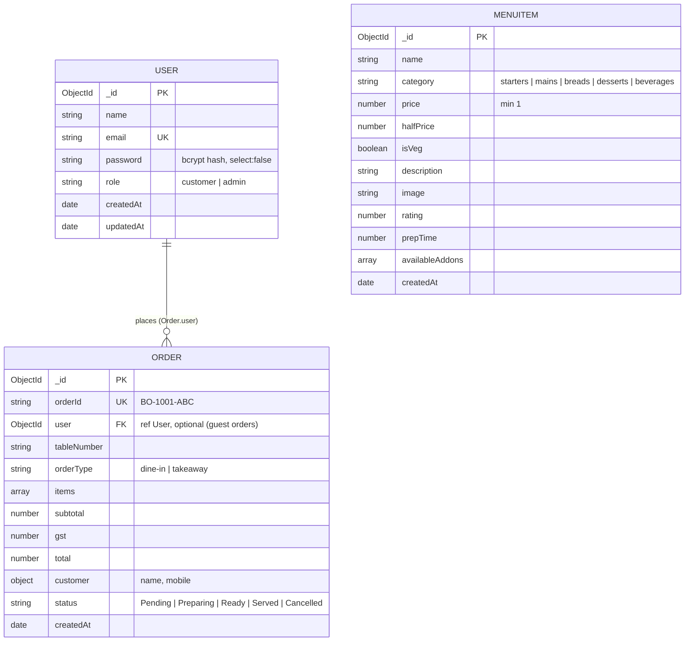

# BiteOrder – Database Schema (MongoDB + Mongoose)

Database: `biteorder` · 3 collections · ODM: Mongoose (`server/models/`)

## `users`  (`models/User.js`)

| Field | Type | Rules |
|---|---|---|
| name | String | required, trimmed, min 2 |
| email | String | required, **unique**, lowercase, regex-validated |
| password | String | required, min 6 → stored as a **bcrypt hash** (pre-save hook, 10 rounds), `select: false` |
| role | String | enum `customer` \| `admin`, default `customer` |
| createdAt / updatedAt | Date | automatic (`timestamps`) |

Methods: `matchPassword(plain)` (bcrypt compare). JSON output never includes `password`.

## `menuitems`  (`models/MenuItem.js`)

| Field | Type | Rules |
|---|---|---|
| name | String | required, trimmed |
| category | String | required, lowercase, enum of 5 categories |
| price | Number | required, min 1 |
| halfPrice, rating (0-5), ratingCount, prepTime | Number | optional (defaults for rating, ratingCount, prepTime) |
| calories | String | default `300 kcal` |
| isVeg | Boolean | default true |
| isBestseller, isChefSpecial | Boolean | optional |
| description | String | default text |
| image | String | URL |
| availableAddons | [{ id, name, price ≥ 0 }] | sub-documents |

**Indexes:** `{ category: 1 }` (category filter) · text index on `name` + `description` (search).

## `orders`  (`models/Order.js`)

| Field | Type | Rules |
|---|---|---|
| orderId | String | **unique**, auto-generated `BO-<n>-<code>` |
| user | ObjectId → `User` | optional (guest orders have none) – the **relationship**; used with `populate('user','name email')` and for ownership checks |
| tableNumber | String | default `12` |
| orderType | String | enum `dine-in` \| `takeaway` |
| items | Array | validator: at least 1 item |
| subtotal, gst, total | Number | min 0 |
| customer | { name, mobile } | defaults for guests |
| status | String | enum Pending/Preparing/Ready/Served/Cancelled, default Pending |

**Indexes:** `{ orderId: 1 }` unique · `{ user: 1, createdAt: -1 }` ("my orders" newest first) · `{ status: 1 }` (admin filtering).

## Relationship handling

`Order.user` references `User._id`.
- **Create:** the logged-in user's id comes from the verified JWT (never from the request body).
- **Read (admin):** `Order.find().populate('user', 'name email')` joins the account details.
- **Authorization:** `Order.findOne({ orderId, user: req.user._id })` – the ownership filter that prevents IDOR.

## Seed data

| Command (in `server/`) | Creates |
|---|---|
| `npm run seed` | 12 sample dishes |
| `npm run seed:admin` | admin account from `ADMIN_EMAIL` / `ADMIN_PASSWORD` (also auto-created on server start) |
| `npm run seed:demo` | sample customer `demo.user@biteorder.com` / `Demo@1234` |
